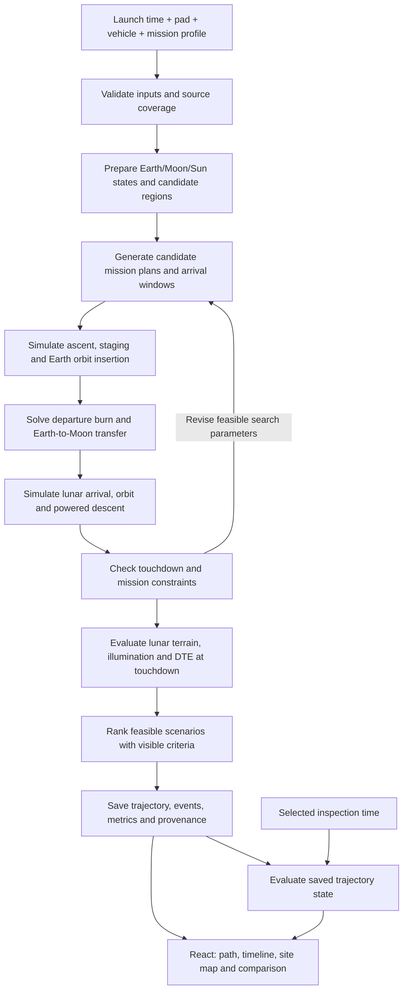

# Moonrizon project pipeline

> Historical planning record, moved inside the backend at the user's request. Current runnable service instructions and backend-local data paths are in [../README.md](../README.md). References to frontend/repository files below are planning context, not runtime dependencies.

**Superseded scope, 2026-11-15.** The general surface engine follows
[criteria](../../docs/criteri-algoritmo.md) and [implementation plan](../../docs/piano-logica.md),
which take precedence over this earlier full-flight pipeline. It accepts a surface epoch T
without a vehicle profile or flight solver; measures Sun/Earth visible-disc fractions,
terrain slope, areas and time windows; and does not produce a global or lexicographic
ranking. Slope bands [0°,5°), [5°,10°), [10°,15°), ≥15° describe terrain rather than
vehicle limits; the automatic 10° filter is removed. Eclipse handling, complete darkness
versus sub-threshold light, separate horizontal elevation/terrain clearance, coverage
limits and convergence are governed by the approved criteria. This file preserves the
older reasoning, not active implementation instructions. Engine implementation comes
before any update to the frontend or its HTTP contract.

## 1. Historical objective discussed on 2026-11-14

The web app should let a user choose **launch date and time**, calculate the **full flight from launch-pad liftoff through ascent, Earth-to-Moon transfer and lunar landing**, and inspect the spacecraft's position at another selected time. It should connect the calculated touchdown time and location to the lunar landing-site analysis: sunlight, Earth visibility, terrain and surface-operation windows.

The full-flight requirement is an addition to the landing-site workflow in [README.md](README.md) and [docs/guida-dati.md](docs/guida-dati.md). [data.md](data.md) records checked source responses, field types, units, and the additional flight-model data needed.

Launch time is a primary user input, but it does not uniquely determine a trajectory. Launch location, hardware, staging, guidance, target and mission constraints must come from a visible, versioned profile or explicit user inputs. The app can make that selection simple; the backend must still have a complete physical scenario.

The intended result is an educational mission-planning simulation with declared assumptions. It is complete only when all requested flight phases are connected and the selected-time position comes from the solved mission.

## 2. What the user does and receives

1. Select launch date/time, launch site and vehicle/mission profile. A preset can supply detailed engineering parameters after the team defines and documents it.
2. Select a target lunar region, surface mission duration and priorities such as sunlight, DTE visibility and terrain slope. Optionally allow the solver to compare several regions.
3. Submit the scenario. The app shows calculation progress and reports missing inputs or infeasible constraints explicitly.
4. View the calculated flight path and phase events: liftoff, staging, orbit insertion, departure burn, transfer, lunar arrival, descent and touchdown.
5. Select a time or move the playback control. The spacecraft marker follows the stored trajectory, and the app displays position, frame/reference body, velocity, altitude where defined, remaining propellant and flight phase.
6. Inspect the calculated lunar touchdown point and its conditions over the surface mission window: terrain horizon, sunlight, Earth visibility, longest outages and next visibility transitions.
7. Compare saved scenarios or change launch time, hardware, destination or constraints and solve again.

Use separate inputs/labels for **launch time**, **inspection time**, **lunar arrival time**, **touchdown time**, and **surface mission duration**. Never use the launch timestamp as the start of landed surface conditions.

## 3. End-to-end flow



Every stage can return a bounded failure or unknown result. Put a limit on candidate iterations and computation time; return diagnostic reasons instead of an endless search. A promising illumination score does not establish that a vehicle can reach and land at that point.

## 4. Prepare data before the user searches

### A. Inventory and source adapters

- Use Moon Trek's product catalog and feature service for available candidate-region polygons. The checked `A3_Named_regions_SP` layer contains 13 regions from **2022**; show its date and verify the desired current list separately.
- Use numeric DEM rasters from ImageServer, or properly decoded PDS LOLA files. Choose one primary acquisition path first. Keep source labels/WKT, valid masks, pixel scale, product version and checksums.
- Obtain geometric Earth, Moon and Sun states plus consistent lunar/Earth orientation. Use Horizons for reference samples and SPICE or another validated local ephemeris source for repeated simulation calls.
- Obtain launch-site, vehicle, atmosphere, gravity, guidance and descent-profile data. These are additional requirements; the checked lunar services do not provide them.
- Discover WMTS layers for visual context. Keep rendered imagery outside numerical terrain calculations.

### B. Build terrain products and caches

1. Intersect each region with available DEM coverage. The checked 5 m polar DEM does not cover every candidate region; select appropriate surrounding products.
2. Acquire fine terrain near analysis points and progressively coarser terrain farther away. Distant terrain may define the horizon. Record the radius cutoff and uncovered directions.
3. Reproject using source lunar WKT and validate frame alignment. Do not silently equate every Mean Earth frame or apply terrestrial coordinate assumptions.
4. Produce slope/quality masks at a declared measurement scale. Retrieve and validate a PSR mask if using it as a constraint.
5. Compute a horizon profile for each evaluated point and observer height. Cache it by position, height, DEM versions, frame, angular sampling, search radius and algorithm version.
6. Start regional processing with a small coarse grid and refine shortlisted areas. Benchmark before generating masks for millions of points.

The horizon cache is reusable across dates **for the same position, height, terrain and conventions**. Changing panel/antenna height can require a new mask. Preserve provenance even when large source files are stored outside Git.

### C. Provision flight profiles

Each usable profile must define launch-pad coordinates/datum, rocket and lander masses, stage separation, engine thrust and Isp behavior, propulsion reserves, aerodynamic/atmospheric models, steering/guidance, parking-orbit objectives, transfer targeting and touchdown limits.

Use one fully documented vehicle/pad combination for the initial demonstration. If it is an illustrative model, say so. Do not claim to simulate a named real rocket using missing or guessed performance data. Record whether the model is translational with prescribed attitude or includes attitude dynamics.

## 5. Solve and propagate the full flight

### Initialization and mission targeting

Convert the user's launch UTC into the propagator's time scale through an established time conversion. Convert the Earth-fixed pad position into the selected inertial frame, including Earth's rotation in its initial velocity. A vehicle stationary on the pad does not have zero inertial velocity.

Select a consistent numerical dynamics engine before implementing this module. Evaluate a framework supporting atmosphere, thrust, mass propagation, events and targeting (for example TudatPy); use matching GMAT cases as an independent reference where applicable. The repository currently has SpiceyPy but no configured full-flight propagator. SPICE supplies geometry and ephemerides; it does not choose ascent guidance or burns for a newly proposed mission.

Guidance and maneuver design determine how a vehicle reaches its target. A fixed steering/burn profile can be propagated; a planner that adapts to launch time and destination also needs a targeting/optimization step. Keep both capabilities explicit.

### Flight phases and required checks

| Phase | Calculation | Output and failure checks |
|---|---|---|
| Prelaunch / liftoff | Rotating launch site, attitude/steering initialization, engine ignition and pad-release conditions | Initial state and actual liftoff event; reject insufficient lift or incomplete profiles. |
| Atmospheric ascent | Integrate gravity, finite thrust, mass depletion, atmosphere-relative aerodynamic forces and steering | Position/velocity/mass; check propellant, dynamic pressure, acceleration and model limits. |
| Staging and Earth orbit insertion | Execute engine cutoffs, separations, ignition/restart rules and orbit targeting | Updated active stack and mass; verify the achieved parking orbit and remaining resources. |
| Parking coast and translunar injection | Coast to the selected departure opportunity and target a finite departure burn | Departure epoch/state, propellant use and transfer constraints. A launch time is not the injection time. |
| Transfer | Propagate coast and planned correction burns with the selected Earth/Moon/Sun gravity model | Encounter state and time; detect collisions, fuel violations or missed encounter constraints. |
| Lunar arrival and orbit insertion | Simulate braking/capture and any required orbital targeting | Achieved lunar orbit and remaining propellant. A flyby is not a completed landing. |
| Lunar coast and descent | Target the rotating surface point; propagate braking/descent thrust with lunar gravity and terrain clearance | Position, velocity and fuel history; detect unintended surface impact or unreachable targets. |
| Touchdown | Locate the terrain-contact event and evaluate relative vertical/horizontal speed and other modeled landing constraints | Accepted touchdown time/location or a failed landing result. Crossing a spherical radius alone is insufficient. |
| Surface stay | Attach the accepted lander position to the lunar surface frame | Surface lighting/DTE metrics and inertial position/velocity accounting for lunar motion and rotation. |

Begin with a documented direct mission architecture following the active stack and delivered lander. Specify staging precisely; complex docking/refueling/rendezvous would require additional phases if a selected real mission depends on them. Do not quietly omit such phases while labelling the result as that real mission.

### Propagated state and numerical model

The minimum translational state is position, velocity and mass. In a suitable inertial frame, its structure is:

```text
dr/dt = v
dv/dt = gravity + (thrust / mass) * thrust_direction + aerodynamic_force / mass
dm/dt = -thrust / (Isp * g0)              # engine model determines thrust and Isp
```

Use consistent SI units. Body positions, frame origins and gravitational parameters must agree. In a frame whose origin accelerates, include the correct indirect terms; do not copy an inertial gravity expression into an Earth-centred translating frame unchanged. Aerodynamic velocity is relative to the rotating atmosphere, not simply inertial speed.

Use adaptive integration and event detection around ignition, cutoff, staging, insertion and surface contact. Store event states. Enforce dry-mass/propellant bounds and restart the appropriate model after a separation or maneuver. Solver tolerance must be smaller than the output error budget, but small numerical tolerance does not eliminate model uncertainty.

A simplified Lambert or patched-conic transfer may initialize the optimizer. It does not by itself simulate launch ascent, lunar capture or a powered landing, so it cannot be the sole implementation of the confirmed full-flight request.

## 6. Evaluate position at a selected time

Persist a mission solution with its model and source versions. On an inspection request:

1. Validate the timestamp against the solution's supported time coverage.
2. Identify the flight phase and active vehicle at that time.
3. Evaluate the numerical solution's continuous output or validated interpolation **within that phase**; use exact event boundaries and avoid smoothing over staging or impulsive burns.
4. Return position/velocity with an explicit origin, frame and units. Also return altitude and surface coordinates in the relevant body's fixed frame where meaningful.
5. Transform for the frontend's render frame and update the marker, event label and values. A geocentric spacecraft state cannot be dropped directly into a lunar body-fixed scene.

Before launch, identify the state as prelaunch on the rotating pad. After accepted touchdown, use lunar surface attachment. Outside a valid solution interval, or after a simulation terminated unsuccessfully, return a clear unavailable/error status. Never extend a trajectory with an arbitrary straight line.

Use reduced samples to render a path smoothly, while keeping authoritative state lookup in the backend. Playback/inspection does not need to re-solve the mission.

## 7. Connect the trajectory to landing-site analysis

For each candidate mission, use the **calculated touchdown epoch** and the selected surface duration. If no trajectory has reached a valid touchdown solution, label surface comparisons as environmental scenarios only.

At the selected surface point:

1. Determine Sun/Earth local azimuth and elevation with consistent lunar orientation and observer altitude.
2. Compare elevation to the cached terrain horizon at that azimuth, with wrap-safe interpolation and documented angular resolution.
3. Apply the selected Sun/Earth visibility definition. Define solar centre versus partial-disc treatment, Earth-centre proxy versus a ground-station model, and antenna clearance margin consistently.
4. Account for solar occultation by Earth if claiming full sunlight availability, or flag eclipse handling as unmodeled. Terrain clearance alone does not address eclipses.
5. Detect and refine visibility transitions. Report sunlight fraction, longest darkness, Earth-visible fraction, longest outage and joint visibility intervals. Refine near transitions instead of assuming hourly samples catch every short window.
6. Preserve unknowns when terrain, ephemerides or PSR/slope coverage are missing. A clipped event window is not proof that sunrise/sunset never occurs.

Solar elevation/visible duration are illumination measures. Actual electrical power requires panel orientation/area, efficiency, temperature, shadow fraction and load/storage models. Earth-centre visibility is a geometric proxy, not a complete communications link budget.

### Historical ranking of mission/location combinations — not adopted for the general engine

- Separate **trajectory feasibility** from **surface suitability**. Reject missions violating modeled vehicle/arrival/landing constraints; mark uncomputed or uncertain cases separately.
- Make environmental constraints configurable: sunlight/DTE at landing, maximum darkness/outage, slope threshold and PSR exclusion. Avoid interpreting a source layer's selection flag as a safety classification.
- Rank eligible cases with explicit components and normalized weights. Fix normalization rules so changing the candidate list does not silently redefine scores.
- Show solved touchdown date, travel duration, propellant margin and surface-window metrics alongside the score. Store the score definition/version.
- Group nearby successful grid points into distinct candidate areas. Use a coarse search then refine before expensive flight optimization on every cell.
- Point or coarse-grid suitability does not establish safety across a landing ellipse. Include footprint analysis if claiming that capability; otherwise label the spatial resolution of the assessment.

## 8. Application architecture

### React + TypeScript + Vite + Cesium

| Module | Responsibility |
|---|---|
| Mission form | Launch UTC, pad, vehicle/profile, lunar target/constraints and surface duration. |
| Mission status/results | Missing-input diagnostics, solver progress, infeasibility reasons, events and assumptions. |
| Flight view | Earth/Moon context, launch location, spacecraft path and selected-time state; explicit rendering transforms. |
| Time control | Absolute-time selector and playback for the solved mission, with phase boundaries. |
| Lunar site view | Region polygons, terrain/score overlay, candidate markers and selected-site horizon. |
| Comparison panel | Mission trajectories and surface metrics for alternate launch times or sites. |
| API client/shared types | Typed requests/results, status handling and cancellation. Keep computation outside React. |

Cesium is already installed but not integrated. Configure body radii, projections and frames deliberately. CAD/GLB can provide vehicle visuals and DEM-derived local meshes; visual meshes or arbitrary drawn paths must not become the source of calculated state.

### FastAPI/Python

```text
backend/app/
  api/                    Mission jobs, state lookup, region/site queries, comparisons
  core/                   Configuration, logging, shared contracts
  services/
    sources/              Horizons, Moon Trek/PDS adapters and source manifests
    ephemerides/          Body states, orientations, frame/time transformations
    terrain/              DEMs, slope/quality masks and horizon profiles
    flight/               Vehicle, atmosphere, guidance, propagation and phase events
    planning/             Mission targeting, constraints and candidate search
    analysis/             Surface visibility, windows, metrics and comparisons
  db/                     Mission metadata, cache index, scenario history
```

This structure preserves the earlier full-flight proposal; its flight/planning modules are not requirements of the approved surface engine. Updated implementation decision (2026-11-14): **FastAPI with file storage, no database**. Preserve source downloads in `data/raw/`; use compressed Parquet tables and JSON manifests in `data/prepared/`, GeoTIFF for terrain and versioned derived files in `data/cache/`. The raw acquisition/preparation commands are implemented; surface-condition metrics and regional comparisons remain to be implemented. Global ranking and flight solving belong to the superseded proposal. Keep reusable request configurations in `backend/config/`; runtime `data/**` files are ignored by Git.

Historical full-flight API proposal, not the approved surface-engine contract or a list of existing endpoints:

| Endpoint | Purpose |
|---|---|
| `GET /api/regions`, `/api/profiles`, `/api/launch-sites` | Return sourced regions and available complete scenario inputs. |
| `POST /api/missions` | Validate a request and submit a flight/landing planning job; return mission/job ID. |
| `GET /api/missions/{id}` | Job status, progress, model metadata and final results. |
| `GET /api/missions/{id}/trajectory` | Bounded/decimated path samples with frames and events. |
| `GET /api/missions/{id}/state?time_utc=...` | Spacecraft state at the requested time from the solved mission. |
| `GET /api/missions/{id}/surface-analysis` | Post-touchdown conditions, windows and provenance. |
| `POST /api/compare` | Compare saved missions/site scenarios under stated criteria. |

Use background jobs for expensive propagation, grid horizons and optimization. Define progress, cancellation, time/memory limits and result reuse; avoid blocking every HTTP request until a whole region finishes. Cache a mission by the complete inputs and source/model versions, not just launch time.

## 9. Validation, uncertainty and failure behavior

| Area | Required evidence before claiming it works |
|---|---|
| Source ingestion | Parse the checked examples in data.md; reject provider errors, unsupported formats, incomplete tables and missing coverage. Preserve source epochs and units. |
| Frames and time | Round-trip Earth/lunar coordinate conversions, UTC/propagator time conversion and known body states. Explicitly handle the pole convention. |
| Flight dynamics | Analytic two-body checks, step/tolerance convergence, consistent thrust/propellant accounting, event continuity and staging resets; compare matched trajectories with an independent implementation/reference. |
| Full flight | A reproducible complete profile reaches all required events, respects modeled constraints and reaches a valid touchdown. A partial transfer plot is not sufficient evidence. |
| Position lookup | Compare inspection states to the solver at ordinary times and before/after events; verify behaviour outside coverage and after touchdown. |
| Lunar geometry | Compare local Sun/Earth angles with matched Horizons queries. Check terrain horizons on synthetic geometry and against QuickMap with the same coordinates and height. |
| Visibility and regional metrics | Refine time/azimuth/radial sampling until results stabilize within an explicit error budget; explain differences with time-averaged reference maps. Missing data must remain unknown, with coverage reported separately. |

Horizons can validate the body's ephemerides and existing spacecraft coverage; it cannot supply the correct reference trajectory for an arbitrary new rocket mission just from a launch timestamp. Compare flight solvers with the same initial conditions, forces and maneuvers.

Handle provider errors independently of HTTP status. Serialize JPL requests, configure the required application contact/User-Agent, cache results and use bounded retries/backoff. A cached ephemeris remains tied to its requested dates, parameters and source version; never reuse another period as a silent substitute. Show provenance and coverage without presenting fabricated confidence values.

For uncertainty analysis, vary documented input ranges such as thrust, mass, launch timing, atmosphere and terrain elevation, then report sensitivity of arrival, propellant margin and surface windows. Monte Carlo is an option after defensible distributions exist. Kalman filtering becomes relevant only if a later feature estimates flight state from actual noisy sensor measurements; it is not a substitute for a dynamics model or source validation.

## 10. AI's role

The planned local AI assistant can translate requests into scenario fields and call deterministic tools such as `plan_mission`, `mission_state_at`, `compare_missions`, `site_summary` and `find_windows`. It can explain returned results and assumptions.

Vehicle physics, trajectory integration, maneuver design, eligibility checks and scoring belong to validated backend code. The assistant must not invent missing vehicle values, replace unavailable trajectory data, or call a failed simulation successful. Model training is not a prerequisite for these capabilities.

## 11. Build order and completion criteria

1. **Confirm one complete scenario/profile.** Source or explicitly define pad coordinates, vehicle/stages, aerodynamic and atmosphere models, guidance, transfer constraints, descent model and touchdown limits. Resolve the external prototype's location and reuse its surface-analysis work where valid.
2. **Implement and validate source adapters and frames.** Reproduce the recorded catalog/features, DEM and ephemeris samples. Add manifests and explicit time/unit/frame conversions.
3. **Establish the flight solver and phase contracts.** Evaluate the dynamics engine, implement events/state persistence, and validate elementary coast/thrust/atmosphere cases.
4. **Implement launch-pad ascent through parking-orbit insertion.** Demonstrate a sourced/preset vehicle reaching a valid orbit with correct mass/staging and constraints.
5. **Implement transfer, lunar capture and descent.** Join phases with continuous physical states, solve guidance/burn targets and detect a valid terrain-relative touchdown. Validate full mission state lookup.
6. **Implement one-site terrain/visibility analysis.** Use actual touchdown time; compare geometry to the reference tools and expose uncertainty/coverage.
7. **Connect mission planning to regional site selection.** Start with a small region/shortlist, use cached horizon data and coarse-to-fine search, and measure runtime before scaling.
8. **Integrate the interactive React application.** Provide launch controls, job progress, full trajectory, selected-time position, lunar detail and comparisons. Presentation may be developed against clearly labelled fixtures while calculations are built.
9. **Add robust demo delivery and the AI tool interface.** Bundle required cached inputs or a documented download process, confirm API/browser deployment connectivity, and prepare reproducible scenarios with failure cases.

These are implementation milestones, not a reduction of the requested scope. A full-flight feature is not complete until liftoff through accepted touchdown and selected-time state evaluation all work together.

## 12. What is still needed to make this work

- A complete launch-site/vehicle/lander scenario and mission architecture; these have not been chosen or supplied by the existing lunar docs.
- A selected dynamics/targeting engine and its dependencies. FastAPI, Rasterio/GDAL, NumPy and SpiceyPy alone are not a configured full-flight mission simulator.
- Atmosphere, aerodynamic and gravity models, Earth orientation, compatible SPICE kernels, and documented guidance/control assumptions.
- A consistent ephemeris route and reference frames. Validate the README's compact global-table reconstruction before relying on its claimed accuracy.
- Real terrain coverage for the search area and surrounding horizon; current checks only fetched a tiny elevation sample.
- Decisions on angular/grid resolution, time refinement, partial-disc/eclipsing treatment, DTE definition, observer height, scoring and footprint claims.
- Tracked manifests/profiles/reference fixtures, provider error handling, cache invalidation rules and job resource limits.
- A backend/frontend data contract, lunar/Earth rendering transforms, scenario persistence and deployment/data-provisioning instructions.
- Numerical reference cases and integration tests. Data-format access has been checked for these docs; no full trajectory or surface model has yet been implemented or validated in this task.

See the live examples and proposed types in [data.md](data.md), the existing surface-data research in [docs/guida-dati.md](docs/guida-dati.md), and the current repository baseline in [README.md](README.md).
